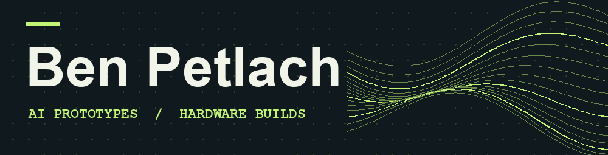
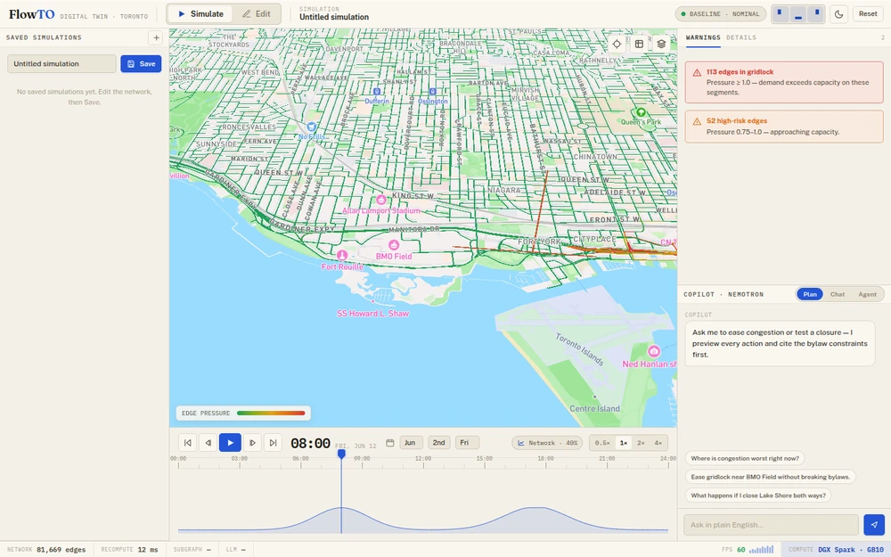
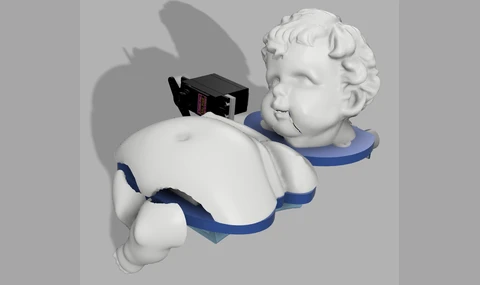
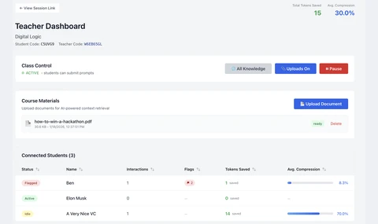
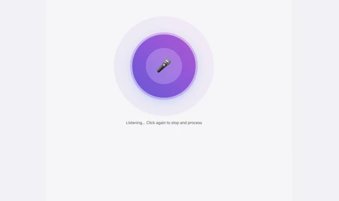
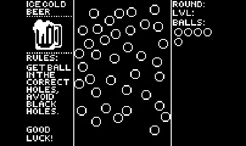

## FlowTO

**1st place, Urban Operations · NVIDIA Spark Hack Toronto · May 2026**

We built a Toronto traffic simulator with an AI copilot running locally on NVIDIA DGX Spark. I worked on the simulation interface, map editing, and landing page.

[Source code](https://github.com/Lironktf/flowTO) · [Watch the demo](https://youtu.be/Yh3Qg2grTw0)

## More projects

<table>
<tr>
<td width="50%" valign="top">

<h3><a href="https://devpost.com/software/shouldercupid-0y6b5d">ShoulderCupid</a></h3>

<strong>MakeUofT 2026 · MLH Best Use of Solana</strong>

Wearable AI coach in a 3D-printed Cupid. I built camera streaming, sensor integration, and remote control.

</td>
<td width="50%" valign="top">

<h3><a href="https://devpost.com/software/glassbox-ez9nym">ClassBox</a></h3>

<strong>NexHacks 2026</strong>

Live AI tutoring grounded in teacher-provided materials. I worked on permissions, sessions, and context compression.

</td>
</tr>
<tr>
<td width="50%" valign="top">

<h3><a href="https://devpost.com/software/vultures-7rjutp">Vultures</a></h3>

<strong>UTRA Hacks 2026</strong>

Autonomous Arduino robot built to navigate an obstacle course, move a cube, and climb ramps.

</td>
<td width="50%" valign="top">

<h3><a href="https://github.com/PhilippMayorov/Iris">Iris</a></h3>

<strong>Dearborn Hacks 2025 · 1st place</strong>

Voice assistant that takes actions across Gmail, Slack, Spotify, and Discord.

</td>
</tr>
<tr>
<td width="50%" valign="top">

<h3><a href="https://github.com/ben-petlach/ice-cold-beer">Ice Cold Beer</a></h3>

<strong>Digital logic</strong>

An implementation of the arcade game using digital logic.

</td>
<td></td>
</tr>
</table>
